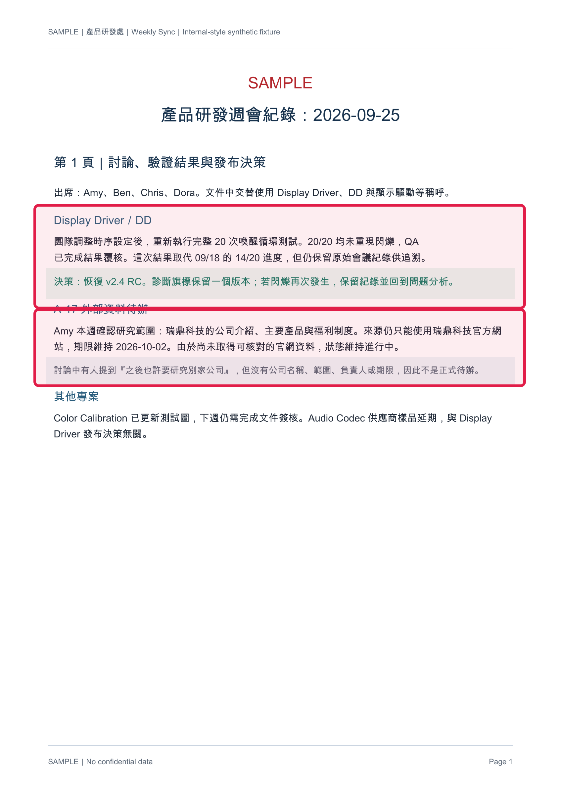
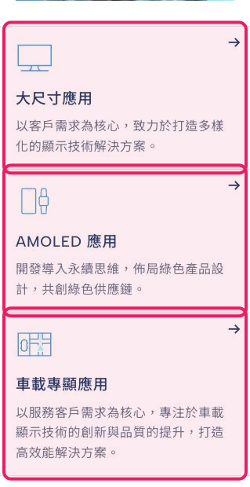
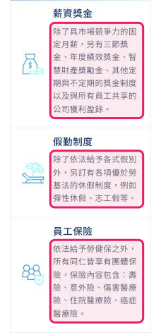
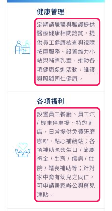
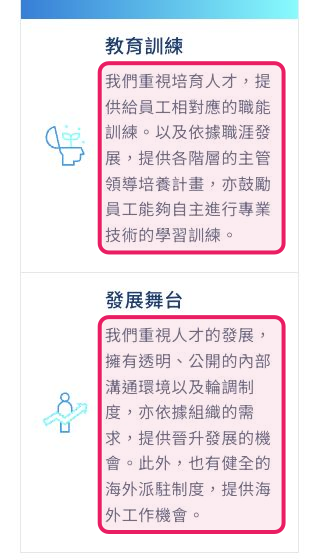

# `integrated-01` 原始來源核對

紅框只標示 Agent 回答實際使用的證據：第一輪圖片來自固定 PDF／PPTX 測試資料，第二輪圖片來自 Browser Task 列出的瑞鼎科技官方網頁。

## Agent 輸出 1：會議待辦來源

### `weekly-meeting-02.pdf` 第 1 頁

### `weekly-meeting-02.pdf` 第 2 頁

### `weekly-report-02.pptx` 第 3 張投影片

## Agent 輸出 2：官網研究來源

### 公司介紹

- 官方來源：https://www.rad-ic.com/zh-TW
- 框選內容：專注半導體技術領域，提供多元解決方案。

### 產品與應用

- 官方來源：https://www.rad-ic.com/zh-TW
- 框選內容：大尺寸、AMOLED 與車載專顯應用，以及各類顯示技術解決方案說明。

### 福利：薪酬、休假與保險

- 官方來源：https://www.rad-ic.com/zh-TW/career/work-in-raydium
- 框選內容：固定月薪及獎金制度、優於法規的休假制度，以及員工團體保險。

### 福利：健康、補助與育兒支持

- 官方來源：https://www.rad-ic.com/zh-TW/career/work-in-raydium
- 框選內容：健康照護、各項補助、居家辦公及育兒津貼。

### 福利：教育訓練與職涯發展

- 官方來源：https://www.rad-ic.com/zh-TW/career/work-in-raydium
- 框選內容：職能訓練、主管培養、專業學習、輪調、晉升及海外工作機會。

