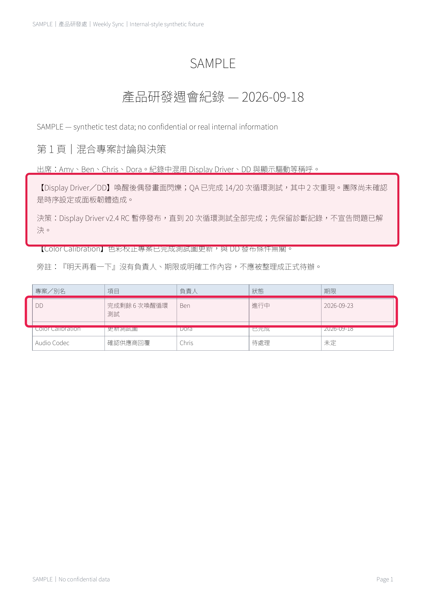
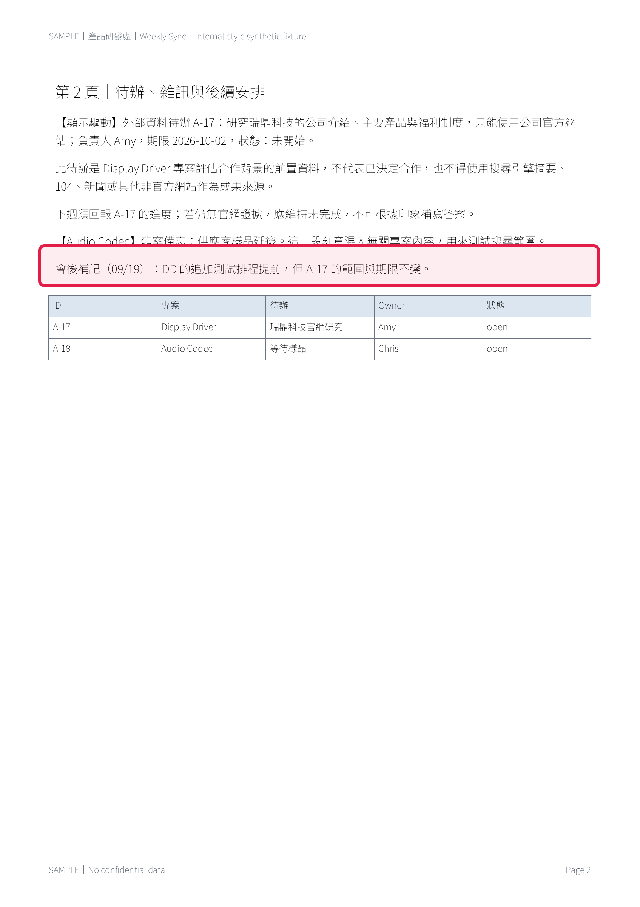
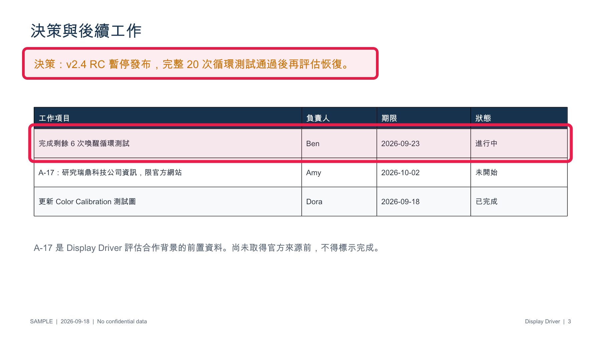
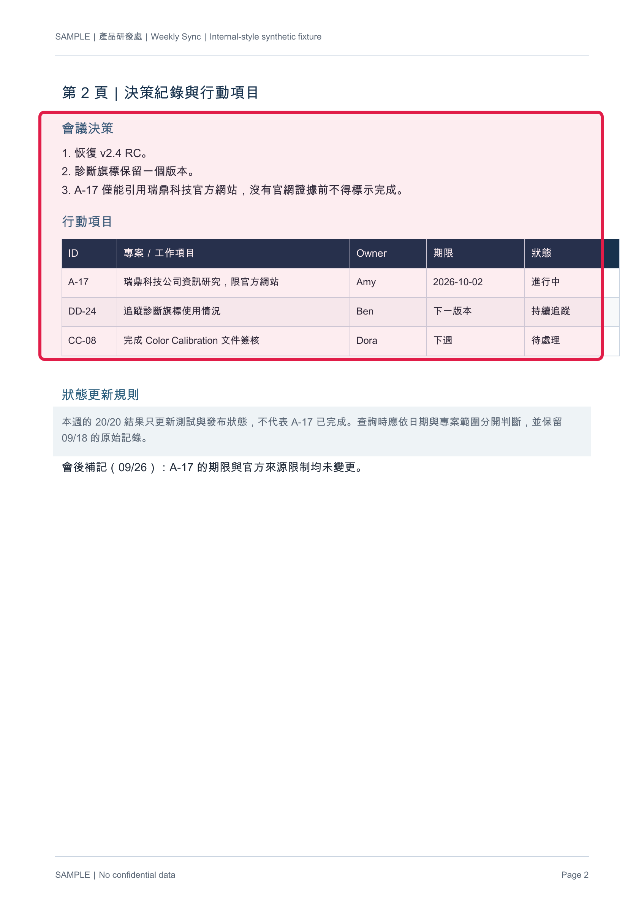
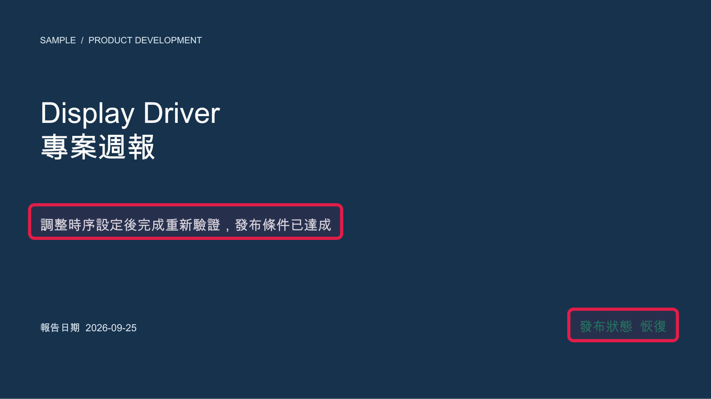
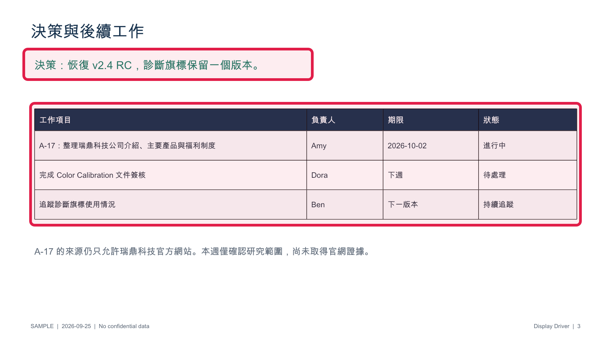

# `question-1-02` 原始來源核對

以下圖片直接由固定測試資料渲染。紅框只標示 Agent 回答所引用的內容，不修改原始 PDF／PPTX。

## `weekly-meeting-01.pdf` 第 1 頁

## `weekly-meeting-01.pdf` 第 2 頁

## `weekly-report-01.pptx` 第 1 張投影片

## `weekly-report-01.pptx` 第 3 張投影片

## `weekly-meeting-02.pdf` 第 1 頁

## `weekly-meeting-02.pdf` 第 2 頁

## `weekly-report-02.pptx` 第 1 張投影片

## `weekly-report-02.pptx` 第 3 張投影片

