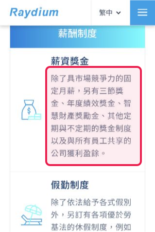
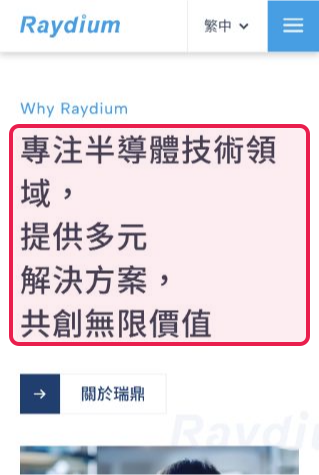
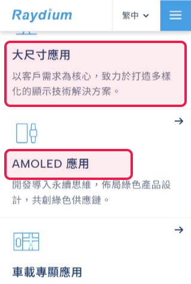

# `question-3-01` 官網來源核對

以下圖片來自 Browser Task 輸出列出的瑞鼎科技官方網頁。紅框只標示輸出中「證據」對應的原文，不以整頁其他內容代替證據。

## 福利制度

- 官方來源：https://www.rad-ic.com/zh-TW/career/work-in-raydium
- 框選內容：固定月薪、獎金制度與公司獲利盈餘分享。

## 公司介紹

- 官方來源：https://www.rad-ic.com/zh-TW
- 框選內容：專注半導體技術領域，提供多元解決方案。

## 主要產品

- 官方來源：https://www.rad-ic.com/zh-TW
- 框選內容：「大尺寸應用」及其顯示技術解決方案說明，以及「AMOLED 應用」類別。

